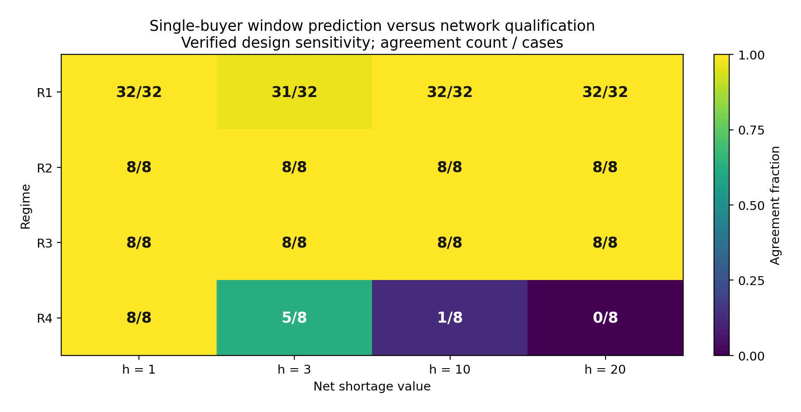

# Paper results package — strategic notices

13 November 2026. This package only rearranges saved, independently verified results. The design set is validation and descriptive evidence; the owner-sealed confirmation set supplies the H1 and gated secondary decisions. No new trajectories, solves, tests, inference resamples, or private-case reads were made for this package.

## 1. Primary and gated secondary results

All five reported contrasts use equal-family network weighting. H1 is the joint requirement that both mean backup displacement **b** and mean extra primary delivery **ΔD** exceed zero. H1c is R1 interior ΔD minus the pooled R2–R4 mean. G(3,5) is supplier payoff gain at margin 3 and shortfall penalty 5. The 98.33% secondary intervals are the frozen Bonferroni intervals. Design intervals are shown for comparison and did not issue gate decisions.

| Contrast | Design estimate [interval] | Confirmation estimate [interval] | Confirmation decision |
|---|---:|---:|---|
| H1: backup displacement b (95.00% interval) | 10.720 [8.280, 13.100] | 10.720 [8.280, 13.100] | H1 passed |
| H1: extra primary delivery ΔD (95.00% interval) | 9.035 [6.672, 11.367] | 9.076 [6.690, 11.421] | H1 passed |
| H1c: R1 versus R2–R4 ΔD (98.33% interval) | 9.375 [6.456, 12.228] | 9.401 [6.460, 12.269] | Passed |
| Supplier gain G(3,5) (98.33% interval) | 23.855 [15.454, 32.223] | 23.966 [15.552, 32.329] | Passed |
| Buyer harm C11−C00 (98.33% interval) | 21.595 [17.032, 26.468] | 21.478 [16.838, 26.386] | Passed |

**Table 1 sources:** design result `bb0a2208ca1668198cdf09ff091d8cdf37fcbfbe0ec9baf8f5897cc0f51ed224`, verification `7a0c0f4218632c47c75b511f76b8a19df0d0c42bbf06b0cbf77f969ade2a3ce1`; confirmation result `f1eef2f55a744295094897ce70a38f5b738ac3e41def05b6d53439fd0a41687b`, verification `8d32d1127ecd229475305361a3bbb9fc434e2422c4057bfdd1120b4ead800040`.

The confirmation network-level sign-flip sensitivity used 100,000 fixed-seed draws: joint p = 9.9999e-06; it agreed with the bootstrap H1 decision. Truthful major notices selected backup in 24/24 R1 interior confirmation networks. The equality of design and confirmation mean b is expected conditional on unchanged qualification choices and fixed allocated lead, outage, and commitment; the structural holdout comparison is ΔD (confirmation 9.07625 versus design 9.03500).

## 2. Four-cell buyer-cost decomposition

C00 is truthful major schedule/long belief; C10 minor schedule/long belief; C01 major schedule/short belief; C11 minor schedule/short belief. Costs and effects below are equal-family means over the 24 interior R1 cases. Contractual = C10−C00; belief = C01−C00; interaction = C11−C10−C01+C00.

| Set | C00 | C10 | C01 | C11 | Contractual | Belief | Interaction | Total harm |
|---|---:|---:|---:|---:|---:|---:|---:|---:|
| Design | 47.808 | 47.808 | 64.008 | 69.403 | 0.000 | 16.200 | 5.395 | 21.595 |
| Confirmation | 45.792 | 45.792 | 61.968 | 67.270 | 0.000 | 16.176 | 5.302 | 21.478 |

**Table 2 sources:** design result `bb0a2208ca1668198cdf09ff091d8cdf37fcbfbe0ec9baf8f5897cc0f51ed224`, verification `7a0c0f4218632c47c75b511f76b8a19df0d0c42bbf06b0cbf77f969ade2a3ce1`; confirmation result `f1eef2f55a744295094897ce70a38f5b738ac3e41def05b6d53439fd0a41687b`, verification `8d32d1127ecd229475305361a3bbb9fc434e2422c4057bfdd1120b4ead800040`.

The zero contractual component is a measured mean under correct beliefs. The observed joint harm runs through the belief component and its interaction with the false schedule.

## 3. Boundary controls and regimes

| Set | Boundary category | Cases | Backup selected in any cell | Mean b | Mean ΔD | Mean buyer harm | Maximum buyer harm |
|---|---|---:|---:|---:|---:|---:|---:|
| Design | fee_closed | 4 | 0 | 0.000 | 0.000 | 0.01562 | 0.05000 |
| Design | inventory_closed | 4 | 0 | 0.000 | 0.000 | 0.00000 | 0.00000 |
| Confirmation | fee_closed | 4 | 0 | 0.000 | 0.000 | 0.02969 | 0.06250 |
| Confirmation | inventory_closed | 4 | 0 | 0.000 | 0.000 | 0.00000 | 0.00000 |

**Table 3a sources:** design result `bb0a2208ca1668198cdf09ff091d8cdf37fcbfbe0ec9baf8f5897cc0f51ed224`, verification `7a0c0f4218632c47c75b511f76b8a19df0d0c42bbf06b0cbf77f969ade2a3ce1`; confirmation result `f1eef2f55a744295094897ce70a38f5b738ac3e41def05b6d53439fd0a41687b`, verification `8d32d1127ecd229475305361a3bbb9fc434e2422c4057bfdd1120b4ead800040`.

The prespecified negative-control prediction concerned backup use and displacement. Three confirmation fee-closed cases had small positive buyer harm, up to 0.06250; this is not a violation of that prediction.

| Set | Regime | n | Truthful-major qualifiers C00 | False-minor qualifiers C11 | Mean b | Mean ΔD | Mean G(3,5) | Mean buyer harm |
|---|---|---:|---:|---:|---:|---:|---:|---:|
| Design | R1 | 32 | 24 | 0 | 8.031 | 6.766 | 17.797 | 16.302 |
| Design | R2 | 8 | 0 | 0 | 0.000 | 0.000 | -3.750 | 0.005 |
| Design | R3 | 8 | 8 | 8 | 0.750 | -0.625 | -5.625 | 27.214 |
| Design | R4 | 8 | 0 | 0 | 0.000 | -0.375 | -3.000 | 0.075 |
| Confirmation | R1 | 32 | 24 | 0 | 8.031 | 6.793 | 17.859 | 16.248 |
| Confirmation | R2 | 8 | 0 | 0 | 0.000 | 0.000 | -3.672 | 0.005 |
| Confirmation | R3 | 8 | 8 | 8 | 0.750 | -0.625 | -5.234 | 26.270 |
| Confirmation | R4 | 8 | 0 | 0 | 0.000 | -0.328 | -3.250 | 0.066 |

**Table 3b sources:** design result `bb0a2208ca1668198cdf09ff091d8cdf37fcbfbe0ec9baf8f5897cc0f51ed224`, verification `7a0c0f4218632c47c75b511f76b8a19df0d0c42bbf06b0cbf77f969ade2a3ce1`; confirmation result `f1eef2f55a744295094897ce70a38f5b738ac3e41def05b6d53439fd0a41687b`, verification `8d32d1127ecd229475305361a3bbb9fc434e2422c4057bfdd1120b4ead800040`. R1 here includes its eight boundary slots; H1 uses the 24 R1 interior cases only.

Descriptively, R3 shows large mean buyer harm from a false minor notice (27.214 in design; 26.270 in confirmation) alongside negative mean supplier gain (−5.625; −5.234). This is consistent with the window model's long-outage reversal: a false minor notice can harm the buyer without benefiting the supplier. R3 is not a separate confirmatory test.

## 4. Critical-penalty distribution

| Set | Finite nonnegative | Invariant positive | Invariant zero | No positive range | Finite minimum | Finite median | Finite maximum |
|---|---:|---:|---:|---:|---:|---:|---:|
| Design | 16 | 8 | 17 | 15 | 6.000 | 43.875 | 50.250 |
| Confirmation | 17 | 7 | 14 | 18 | 6.000 | 44.625 | 186.000 |

**Table 4 sources:** design result `bb0a2208ca1668198cdf09ff091d8cdf37fcbfbe0ec9baf8f5897cc0f51ed224`, verification `7a0c0f4218632c47c75b511f76b8a19df0d0c42bbf06b0cbf77f969ade2a3ce1`; confirmation result `f1eef2f55a744295094897ce70a38f5b738ac3e41def05b6d53439fd0a41687b`, verification `8d32d1127ecd229475305361a3bbb9fc434e2422c4057bfdd1120b4ead800040`. Categories cover all 56 cases per set. The finite quantiles refer only to finite nonnegative thresholds; other cases remain in the denominator of the category counts.

## 5. Verified design sensitivity

These ten rows are descriptive design-set results at multiplier 1.0. Entries are mean [minimum, maximum] over 56 cases. The h=20 baseline is the already verified design result, carried into the fixed table.

| Arm / fixed level | b | ΔD | e | Accepted shortfall s | Supplier gain | Buyer harm |
|---|---:|---:|---:|---:|---:|---:|
| baseline / h20 | 4.696 [0.000, 18.000] | 3.723 [-2.000, 16.750] | -0.973 [-2.750, 0.000] | 0.554 [0.000, 1.000] | 8.402 [-11.000, 48.000] | 13.215 [0.000, 39.925] |
| backlog_catchup / catchup_0.5_cost_1 | 1.286 [0.000, 18.000] | 1.013 [-1.000, 15.000] | -0.272 [-3.000, 0.000] | 0.540 [0.000, 1.000] | 0.339 [-8.000, 45.000] | 3.116 [0.000, 25.200] |
| broker_spot / capacity_0.5_price_6 | 3.643 [0.000, 18.000] | 2.804 [-2.000, 16.750] | -0.839 [-2.750, 0.000] | 0.554 [0.000, 1.000] | 5.643 [-11.000, 45.250] | 7.107 [0.000, 28.000] |
| positive_contradiction_fee / F3 | 4.696 [0.000, 18.000] | 3.723 [-2.000, 16.750] | -0.973 [-2.750, 0.000] | 0.554 [0.000, 1.000] | 5.402 [-14.000, 45.000] | 13.215 [0.000, 39.925] |
| no_damages / lambda0 | 4.696 [0.000, 18.000] | 3.723 [-2.000, 16.750] | -0.973 [-2.750, 0.000] | 0.554 [0.000, 1.000] | 11.170 [-6.000, 50.250] | 13.215 [0.000, 39.925] |
| long_type_expedite / advance_1_cost_3 | 4.696 [0.000, 18.000] | 3.741 [-2.000, 16.750] | -0.955 [-2.750, 1.000] | 0.536 [0.000, 1.000] | 8.491 [-11.000, 48.000] | 12.858 [-19.988, 39.925] |
| backup_price_parity / price_1 | 4.696 [0.000, 18.000] | 3.723 [-2.000, 16.750] | -0.973 [-2.750, 0.000] | 0.554 [0.000, 1.000] | 8.402 [-11.000, 48.000] | 14.389 [0.000, 39.925] |
| net_shortage_value / h1 | 0.000 [0.000, 0.000] | -0.071 [-1.000, 0.000] | -0.071 [-1.000, 0.000] | 0.554 [0.000, 1.000] | -2.982 [-8.000, 0.000] | 0.043 [0.000, 1.000] |
| net_shortage_value / h3 | 0.857 [0.000, 18.000] | 0.362 [-2.000, 13.250] | -0.496 [-4.750, 0.000] | 0.554 [0.000, 1.000] | -1.683 [-11.000, 34.750] | 0.765 [0.000, 5.925] |
| net_shortage_value / h10 | 4.071 [0.000, 18.000] | 3.165 [-2.000, 16.750] | -0.906 [-2.750, 0.000] | 0.554 [0.000, 1.000] | 6.728 [-11.000, 48.000] | 5.272 [0.000, 19.925] |

**Table 5a sources:** design sensitivity result `99c1b064b04e7cc65a97620b8f94d44ff6a27ff3eeb0841f7ac9a62497613763`, verification `f654c62d1065035f3eb061fd160e210488a01f55c2482a3ecb91c8ffd5de1055`.

| Arm / fixed level | Contractual | Belief | Interaction | Truthful qualifiers | G0 window agreement | Critical-penalty categories | Terminal backlog C00 / C11 |
|---|---:|---:|---:|---:|---:|---|---:|
| baseline / h20 | 0.000 [0.000, 0.000] | 10.794 [0.000, 39.925] | 2.421 [0.000, 38.000] | 32/56 | 48/56 | finite_nonnegative:16, invariant_positive:8, invariant_zero:17, no_positive_range:15 | 0.000 / 0.000 |
| backlog_catchup / catchup_0.5_cost_1 | 0.000 [0.000, 0.000] | 2.161 [0.000, 23.600] | 0.955 [0.000, 25.200] | 37/56 | 43/56 | finite_nonnegative:10, invariant_negative:3, invariant_positive:5, invariant_zero:17, no_positive_range:21 | 0.964 / 1.179 |
| broker_spot / capacity_0.5_price_6 | 0.000 [0.000, 0.000] | 5.001 [0.000, 24.925] | 2.106 [0.000, 23.000] | 27/56 | 43/56 | finite_nonnegative:16, invariant_positive:3, invariant_zero:22, no_positive_range:15 | 0.000 / 0.000 |
| positive_contradiction_fee / F3 | 0.000 [0.000, 0.000] | 10.794 [0.000, 39.925] | 2.421 [0.000, 38.000] | 32/56 | 48/56 | finite_nonnegative:16, invariant_negative:17, invariant_positive:8, no_positive_range:15 | 0.000 / 0.000 |
| no_damages / lambda0 | 0.000 [0.000, 0.000] | 10.794 [0.000, 39.925] | 2.421 [0.000, 38.000] | 32/56 | 48/56 | undefined_no_damages:56 | 0.000 / 0.000 |
| long_type_expedite / advance_1_cost_3 | 0.000 [0.000, 0.000] | 10.794 [0.000, 39.925] | 2.064 [-19.988, 38.000] | 32/56 | 48/56 | undefined_option_may_reselect:56 | 0.000 / 0.000 |
| backup_price_parity / price_1 | 0.000 [0.000, 0.000] | 11.772 [0.000, 39.925] | 2.617 [0.000, 39.000] | 32/56 | 48/56 | finite_nonnegative:16, invariant_positive:8, invariant_zero:17, no_positive_range:15 | 0.000 / 0.000 |
| net_shortage_value / h1 | 0.000 [0.000, 0.000] | 0.028 [0.000, 1.000] | 0.015 [0.000, 0.200] | 1/56 | 56/56 | invariant_zero:25, no_positive_range:31 | 0.000 / 0.000 |
| net_shortage_value / h3 | 0.000 [0.000, 0.000] | 0.679 [0.000, 5.925] | 0.086 [0.000, 4.000] | 14/56 | 52/56 | finite_nonnegative:6, invariant_positive:1, invariant_zero:24, no_positive_range:25 | 0.000 / 0.000 |
| net_shortage_value / h10 | 0.000 [0.000, 0.000] | 4.434 [0.000, 19.925] | 0.838 [0.000, 18.000] | 30/56 | 49/56 | finite_nonnegative:14, invariant_positive:8, invariant_zero:17, no_positive_range:17 | 0.000 / 0.000 |

**Table 5b sources:** design sensitivity result `99c1b064b04e7cc65a97620b8f94d44ff6a27ff3eeb0841f7ac9a62497613763`, verification `f654c62d1065035f3eb061fd160e210488a01f55c2482a3ecb91c8ffd5de1055`. Critical-penalty categories are fixed-arm descriptive classifications; “undefined” categories are retained. The expedite arm has one C11 expedite choice and none in the other cells.

## 6. Window-prediction agreement

**Figure 1 sources:** design sensitivity result `99c1b064b04e7cc65a97620b8f94d44ff6a27ff3eeb0841f7ac9a62497613763`, verification `f654c62d1065035f3eb061fd160e210488a01f55c2482a3ecb91c8ffd5de1055`. Values are agreement counts out of each regime’s case count (R1: 32; R2–R4: 8 each). G0 is a single-buyer, no-spot comparator. The 19 disagreements across h=1,3,10,20 all occur where at least one G0 assumption fails; they are not calibration failures of the network planner. See the [verified sensitivity report](../V3_DESIGN_SENSITIVITY_R3_VERIFIED_REPORT.md) for each case and failed assumption.

## Provenance and limits

The [provenance file](PROVENANCE.json) contains full source paths and SHA-256 hashes. [Engineering deviations and amendments](DEVIATIONS.md) covers v1–v3. Confirmation tests structural redraws at allocated factor levels; it does not establish parameter-range generalization. All sensitivity rows are design-only and did not change the frozen confirmatory analysis. M5 and the LLM arm remain paused.
